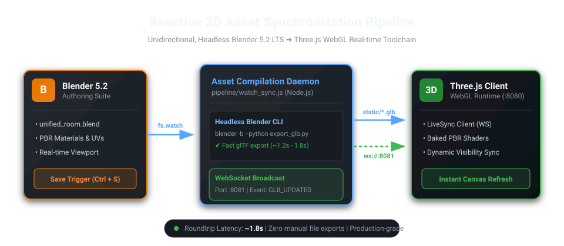
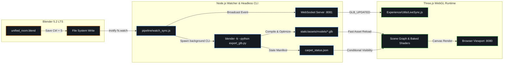

# Interactive 3D Developer Portfolio & WebGL Room

An interactive 3D web experience built with **Three.js** and **WebGL**, featuring an isometric room environment, custom GLSL shaders, baked PBR lighting textures, and an automated, reactive **Blender ➔ Three.js synchronization pipeline** for real-time asset compilation.

<p align="center">
  
</p>

---

## Highlights

- **Real-Time 3D LiveSync Pipeline:** Unidirectional, headless compilation pipeline bridging Blender 5.2 LTS and Three.js in ~1.8s without manual exports or heavyweight UI socket add-ons.
- **Procedural & Baked Lighting:** Hybrid rendering workflow combining pre-rendered high-resolution baked lightmaps with custom GLSL shaders (shell texturing for carpet fibers, CRT monitor scans, loading transitions).
- **Interactive Scene Graph:** Raycaster-driven navigation, camera transitions, and dynamic scene state synchronized with 3D model datablocks.
- **Clean Architecture:** Modular ES6 design separating scene composition, resource loading, materials, navigation, and audio management.

---

## Architecture Overview



### How the 3D Pipeline Works

1. **Blender Authoring (Source of Truth):** 3D objects, transforms, and materials are modified directly inside `unified_room.blend`.
2. **Operating System File Watcher:** Node.js monitors the `.blend` file using debounced `fs.watch` (500ms threshold).
3. **Headless Python Compiler:** Spawns `blender -b` in the background executing [`pipeline/export_glb.py`](pipeline/export_glb.py), enforcing standard WebGL conventions (`+Y Up`, normalized UVs, PBR extraction, conditional component splitting).
4. **Reactive Manifests:** Auxiliary states (such as procedural mesh visibility or conditional sub-models) are serialized into lightweight JSON manifests.
5. **WebSocket Push & Hot Reload:** A WebSocket server on port `8081` pushes a `GLB_UPDATED` notification to the frontend client (`LiveSync.js`), refreshing the 3D scene instantaneously.

---

## Tech Stack

- **Core 3D Engine:** Three.js (r140+)
- **Shaders:** WebGL GLSL (Shell texturing, screen shaders, loading overlay)
- **Asset Modeling & Baking:** Blender 5.2 LTS (Principled BSDF, Cycles baking)
- **Texture Formats:** KTX2 / Basis Universal, PNG
- **Automation & Tooling:** Node.js, WebSockets (`ws`), Headless Blender CLI
- **Build System:** Webpack 5, Babel

---
## Project Structure

```
├── bundler/                      # Webpack configuration (dev & prod)
├── pipeline/                     # Real-time 3D sync pipeline
│   ├── export_glb.py             # Headless Blender Python compiler
│   ├── watch_sync.js             # inotify watcher & WebSocket broadcast daemon
│   └── README.md                 # Pipeline technical documentation
├── src/
│   ├── Experience/               # Core Three.js architecture
│   │   ├── Utils/                # Utilities (LiveSync, Resources, Sizes, Time)
│   │   ├── shaders/              # Custom GLSL shaders
│   │   ├── Baked.js              # PBR lightmap binding & material configuration
│   │   ├── Camera.js             # Isometric & fly-to perspective cameras
│   │   ├── Navigation.js         # Raycasting, points of interest & controls
│   │   ├── Renderer.js           # Post-processing & WebGLRenderer pipeline
│   │   └── World.js              # Scene composition orchestrator
│   ├── index.html                # Entry HTML shell
│   ├── script.js                 # Application bootstrapper
│   └── style.css                 # UI styling & interactive overlays
└── static/assets/                # Web-ready models, textures & audio assets
```

---

## Getting Started

### Prerequisites

- **Node.js** (v18.x or later)
- **Blender** (v4.x / 5.x installed and accessible via `blender` in system `PATH`)

### Installation

```bash
git clone https://github.com/aleocampodev/portfolio-ale.git
cd portfolio-ale
npm install
```

### Development Commands

#### 1. Full Development Mode (Web + 3D LiveSync)
Runs the Webpack dev server on port `8080` alongside the 3D asset synchronization daemon on port `8081`:
```bash
npm run dev:all
```

#### 2. Web Development Only
Runs only the Three.js client application:
```bash
npm run dev
```

#### 3. Standalone 3D Compilation
Manually triggers a headless export of the active `.blend` scene into WebGL `.glb` assets:
```bash
npm run export:glb
```

#### 4. Production Build
Generates an optimized static bundle in `dist/` ready for deployment:
```bash
npm run build
```

---

## License

MIT License © [Ale Ocampo](https://github.com/aleocampodev)
